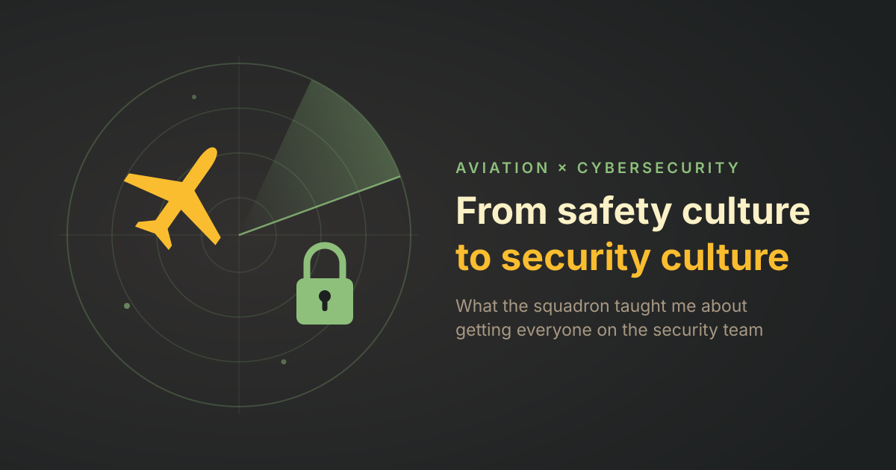
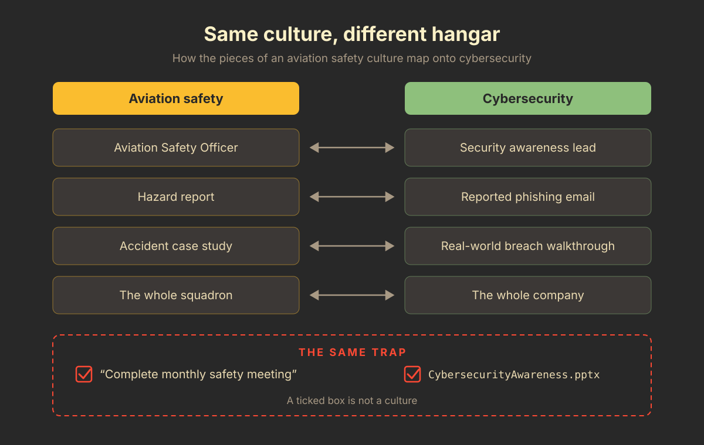
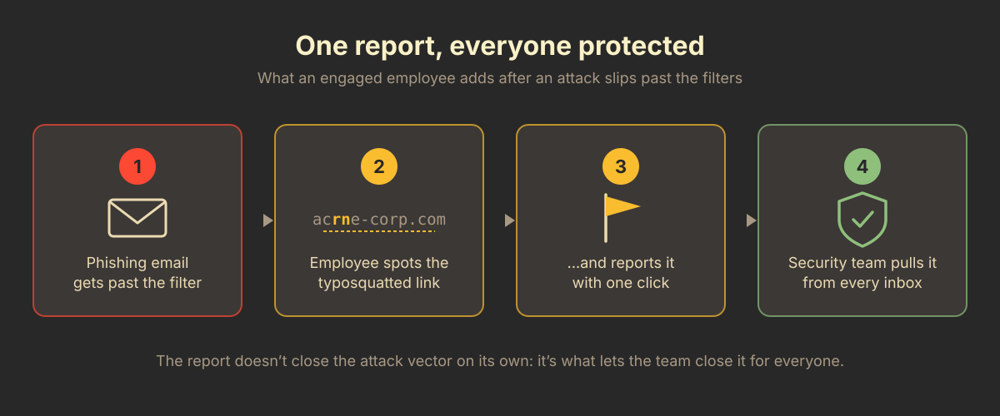

Very early on in my career as a military pilot I was introduced to the concept of a healthy Aviation Safety Culture. I count myself extremely fortunate that when it was first presented to me, it was done in such a way that I could immediately grasp its intrinsic value, and why I too should take it seriously. It really clicked and stuck with me, and I wanted to share this knowledge with others. After experiencing the impact of highly competent Aviation Safety Officers at my first squadron, I asked to attend the courses to become an Aviation Safety Officer, a role which I went on to hold at two later squadrons.

It seems like a given that aircrew should care deeply about aviation safety: they have a personal interest in the concept, after all. There is, however, some nuance here: I am not referring to doing what is required to conduct a safe flight, but rather adopting Aviation Safety as a way of life, which is why it is often referred to as the Aviation Safety _Culture._ To think that aviation safety is only of concern to aircrew would be a naive approach that could prove to be a fatal miscalculation. The technician who's had a sleepless night and so struggles to concentrate incorrectly reassembles the tail rotor of a helicopter, which could lead to a catastrophic tail rotor failure on the next flight. Or a firefighter who’s just suffered the loss of a family member distractedly forgets to repack the hose connector into the accessories box; a week later when they arrive at the scene of an aircraft accident with no way to connect the fire hose to the fire truck. The air traffic controller who's just been reprimanded in front of colleagues right before starting their shift may be angry or embarrassed and miss two aircraft on a collision course. With even just a little imagination, we can find countless potential examples.

## Action, not words.
"We take aviation safety seriously" can be a virtuous thing to say, but there have to be practical implications. It has to actually _mean_ something. Aviation safety is a massive topic, and there is way more to discuss than what would be useful in a single article (I plan to cover at least the Swiss cheese model and Just Culture in future articles), but I’ve come to believe that there is a larger overlap between aviation safety and cybersecurity than a cursory glance may suggest. Both are concerned with protecting valuable assets, identifying and mitigating risk, taking action in the event of an incident, and crucially, both require the involvement of the entire organisation to be successful, and not just the team formally entrusted with mitigating the risk. Without a healthy culture towards securing our systems, whether digital or physical, we are fighting the battle with our hands tied behind our backs.

## Make it interesting.
In the Air Force, we would have monthly 'training days' where each squadron would come together as a whole and different stakeholders would present to review the month’s activities, achievements, opportunities for improvement, lessons learnt etc. These would generally last half a day, and the compulsory monthly aviation safety meeting was a natural fit for the training day. Unfortunately, while some people do get value out of these types of meetings, not everyone wants to be there. They have a lot of work to do and are counting down the minutes until they can get back to tackling their backlog rather than listening to a lot of statistics they don't really care about. They may be in the room, but they are not really present. I saw a similar pattern when I had a stint as a backend developer where there was a lot of grumbling from my colleagues each time we had some sort of professional development session: they would much rather be coding at their desks. I would wager that this is a universal theme: we generally have more work than we have time for and attending meetings we don’t see as meaningful feels like a frustrating waste of time. As cybersecurity affects every company that uses computers, this same truth will undoubtedly hold here as well.

During my time as a pilot, I've been in countless aviation safety meetings, and unfortunately not all of them fulfilled the task that they were meant to. During some, a quick scan across the room would reveal stifled yawns, glances at watches and blank stares as a dry set of stats or regurgitated presentations were given: a waste of everyone’s time. The most effective safety meetings, the ones that engaged the audience and raised awareness but also inspired people to _be involved_ in the hazard identification and reporting process, were interactive, real-world case studies. We would dissect a real accident and with input from the audience discover how the factors leading up to the accident could have been identified and mitigated. Together, we would identify and observe poor decision making, inadequate procedures, regulatory failures, etc., and see their impact. We would learn _how to identify the risks ourselves_ and see how reporting them to the relevant people could be enough to avoid catastrophe. We would understand that the scope of aviation safety is broader than just the aircraft, that losing a finger in the workshop due to inadequate safety equipment is part of aviation safety and that every report is valuable and can make _the_ difference. This is how the Aviation Safety Culture is nurtured and fostered.

## Humans make mistakes.
Just like in aviation, human error remains one of the leading contributing factors to incidents. There are robust systems in place to prevent failures, and in the case of security a whole cybersecurity team dedicated to preventing security incidents. That is why phishing, which targets people rather than systems, remains one of the leading initial access vectors. A non-technical, overworked employee who is struggling financially and hasn’t slept well may have compromised judgement and click a link they would normally know to avoid. With the advancements in AI, phishing emails look more authentic and are becoming increasingly difficult to identify. One click is enough to give the attacker a foothold, and if not detected by the security team, the damage is done. With a robust awareness campaign, the same person may have spotted the [typosquatting](https://www.sentinelone.com/cybersecurity-101/cybersecurity/what-is-typosquatting/) in the link, reported the email and closed the attack vector for everyone instead of potentially allowing an attacker access to the network. But awareness only works if the employee was engaged in the awareness training, both during the training and afterwards in their own minds.

When we talk about something as important as aviation safety, where real lives are at risk, we can't just gloss over that fact or be glad that we ticked the box of "complete monthly safety meeting". As the custodian of aviation safety at the squadron, it is the responsibility of the Aviation Safety Officer to get maximum buy-in from the squadron, and so mitigate the maximum amount of risk. Choosing the right aviation safety officer is critical. Similarly, there are real-world and potentially serious consequences if a network is breached, both to the company itself and to its customers. Customers could lose sensitive information that could be used for nefarious purposes. Both customers and the company itself could suffer significant financial losses. That’s not even considering other factors like reputational damage, loss of intellectual property, legal complications etc. Simply distributing the annual `CybersecurityAwareness.pptx` is probably not very effective. The box it ticks on the audit is probably the only meaningful outcome of the whole exercise.

## Team effort.
Of course, companies vary significantly and have vastly differing resources available to invest in cybersecurity, but I would argue that fostering a security culture is a cheap investment with an outsized return if done right. It has to be done intentionally and the person running it should be given the required support to effectively fulfil their mission. Security awareness training that is engaging and tailored to the company culture helps employees buy into the concept in their day-to-day activities. Implementing easy cyber risk reporting mechanisms, and showing during training how a single report can make _the_ difference to stopping an attack, gets everyone on board. If done right, this is an absolute force multiplier: the entire company becomes part of the cybersecurity team. Securing our networks is only getting harder, especially with the recent advances in AI. Technology will always be the first line of defence, but when an attack slips past the filters, the first person to spot it may well be someone in finance who thought it might be worth reporting.

In the opening paragraph I alluded to what made me buy into Aviation Safety Culture: _inspiration_. It took one meeting with someone who took the time to lay out in clear terms how I could practically and realistically make a difference to keep our squadron safer. Their safety awareness meetings were not just a tick in the box, but an active attempt to foster a safety culture that for me has gone beyond aviation. For over 20 years I have applied the principles I learnt there to my daily life in a wide variety of circumstances: that’s what I would call a culture. The fact that cybersecurity feels so closely related to aviation safety is maybe why I am so drawn to the field. It genuinely excites me that so many aviation safety principles translate so neatly into this field and that’s a large part of the value I see in this as a career: cybersecurity professionals can make a tangible difference in protecting real people and assets.